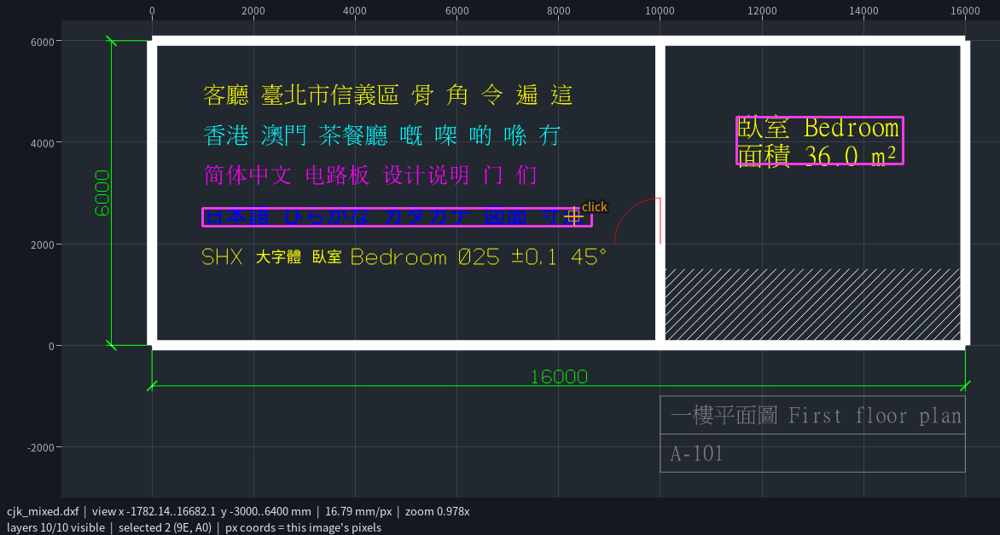

# cad-eye-mcp

**讓 AI 自己操作 CAD 檢視器的 MCP 伺服器。** AI 拿到的不是一張固定的截圖。它會自己開啟圖面，再縮放、平移、點選物件、開關圖層和量測，每做一步就看一次結果，像人一樣把圖看懂。

支援 **DXF**、**DWG** 和 PCB 的 **Gerber / Excellon** 鑽孔檔（可以是單一檔案、資料夾或 zip）。台灣、港澳、中國大陸的中文，以及日文、英文，都會以正確字形顯示。

[English](README.md)



## AI 看到什麼

每個動作都會回傳**新的畫面**（PNG）和一段簡短的 JSON 狀態：

- 上方和左方有以圖面單位標示的**座標尺**，加上淡格線，可以直接從圖上讀出位置。
- 選取的物件以**洋紅色**標出，太小看不見的物件會加一個圓圈。
- **標記**和**量測線**以橘色顯示。
- 放大時，右上角會出現整張圖的**小地圖**，標出目前看的位置。
- 底部的**狀態列**顯示目前範圍、每像素代表多少單位、縮放倍率、可見圖層數和選取狀態。

工具的座標可以用 `px`（剛剛那張圖的像素）或 `world`（圖面單位）表示，AI 看到哪裡就能直接指哪裡。

| 工具 | 功能 |
|---|---|
| `open_drawing` | 開啟 DXF、DWG、Gerber/鑽孔檔、資料夾或 zip，顯示全圖 |
| `look` | 重新顯示目前畫面 |
| `zoom` / `zoom_window` / `zoom_extents` / `zoom_to` | 以某點為中心縮放（像滾輪）、框選縮放、顯示全圖、縮放到指定圖元 |
| `pan` / `back` | 平移；回到上一個視角 |
| `click` | 點選某處的物件，取得精確資料（類型、圖層、座標、文字、圖塊屬性、長度等），並列出附近其他可能的物件 |
| `select_window` / `select` / `clear` | 框選（可依類型或圖層篩選）、依 handle 選取、清除 |
| `inspect` | 圖元的所有 DXF 屬性、實際顏色、外框、長度/面積、圖塊內容 |
| `find` | 搜尋文字（標籤、元件編號、屬性）或圖元類型，並跳過去 |
| `measure` | 點與點之間的距離、角度和面積，或圖元的長度/面積 |
| `layers` | 列出圖層；顯示、隱藏或只顯示指定圖層 |
| `layout` | 在模型空間和圖紙空間配置（有標題欄、視埠、注意事項、表格的圖紙）之間切換 |
| `mark` | 在圖上放帶標籤的標記，標出發現的問題 |
| `screen_settings` | 畫面大小、格線、小地圖、中日文字形地區 |
| `cad_command` | 直接執行 CADCraft 的 400 多個 AutoCAD 風格指令（存檔和匯出會被擋下） |

不會修改任何檔案。

## 安裝

安裝器會把所有東西放進這個資料夾的 `runtime/`：portable Python、Python 套件、CADCraft 引擎和中日文字型。不會動到系統的 Python、PATH、登錄檔或系統字型。每個下載檔都固定版本，並依 [`runtime.lock.json`](runtime.lock.json) 驗證 SHA-256。要移除時，刪掉整個資料夾即可。

```sh
git clone https://github.com/trajis-tech/cad-eye-mcp.git
cd cad-eye-mcp
```

**Windows**（PowerShell）：

```powershell
powershell -ExecutionPolicy Bypass -File install.ps1
```

**Linux / macOS**：

```sh
./install.sh
```

總下載量約 150 MB。安裝完成後會自動檢查，並印出註冊伺服器用的指令。

## 連接 MCP 客戶端

伺服器透過 stdio 使用 MCP。執行檔是這個資料夾裡的 `cad-eye-mcp.cmd`（Windows）或 `cad-eye-mcp`（Linux/macOS）。

**Claude Code**

```sh
claude mcp add cad-eye -- "D:\path\to\cad-eye-mcp\cad-eye-mcp.cmd"
```

**Claude Desktop、Cursor、VS Code 等**（JSON 設定）：

```json
{
  "mcpServers": {
    "cad-eye": { "command": "D:\\path\\to\\cad-eye-mcp\\cad-eye-mcp.cmd" }
  }
}
```

接著就可以這樣問：「打開 D:\\boards\\rev3.zip，檢查頂層銅箔有沒有走線離固定孔不到 0.2 mm。」

## 運作方式

```
AI 客戶端 ──MCP──▶ cad-eye-mcp（Python）──MCP──▶ cadcraft-cli mcp（無頭 CADCraft）
                     │ 視角狀態、座標尺、點選、          開啟 DXF/DWG、圖層狀態、
                     │ 高亮、小地圖、量測               算出指定範圍的 PNG
                     └─ ezdxf：精確的圖元資料，以及點選與高亮用的幾何
                        gerbonara：Gerber/Excellon → 分層 DXF
```

- [CADCraft](https://github.com/storytold/cadcraft) 是畫面引擎，負責算圖、保存圖層狀態和讀取 DWG。即使是 20 萬個圖元的電路板，每張畫面也只要約 0.1 到 0.4 秒。
- [ezdxf](https://github.com/mozman/ezdxf) 讀取同一份 DXF。兩邊保留相同的 handle，所以點在哪個像素，都能精確對應到哪個圖元。DWG 會由 CADCraft 在快取資料夾另存一份 DXF 給 ezdxf 讀。
- Gerber 和鑽孔檔用 [gerbonara](https://gitlab.com/gerbolyze/gerbonara) 轉成實心的 DXF 幾何，每個 PCB 層對應一個 DXF 圖層（`F.Cu`、`B.Cu`、`In1.Cu`、`F.SilkS`、`Edge.Cuts`、`Drill.PTH`…）。防焊、鋼板和底層絲印預設隱藏。轉換結果會快取。
- CADCraft 畫不出來的圖元類型會改用替代圖形顯示：
  - AutoCAD Mechanical、Civil 3D 等應用程式的自訂物件（proxy entity）顯示它們的 proxy graphics，也就是沒裝該應用程式時 AutoCAD 自己顯示的替代圖形。
  - 弧長標註和大半徑標註顯示它們的標註圖形。
  - 平面構成的 ACIS 實體和網格（MESH）顯示線框。

  點選替代圖形時，`drawn_for` 會指出原本的物件；仍然畫不出來的會在開圖時列在 `not_drawn`。
- 表格（`ACAD_TABLE`）可以點選和搜尋，`inspect` 會逐列回傳儲存格文字。
- 沒有圖元 handle 的舊 DXF（I-DEAS、CAM 軟體等 R12 輸出）會先由 CADCraft 另存一份，讓兩邊的圖元編號一致。
- 外部參考（xref）的檔案只要放在圖檔旁邊就會載入；找不到的會在開圖時列出。

### 中日文字

runtime 內附 Noto Sans CJK，一個字型集就涵蓋繁體中文、港字（HKSCS）、簡體中文和日文。開圖時，伺服器會依圖面上的文字自動選擇字形地區（TC、HK、SC 或 JP）。也可以用 `screen_settings(cjk=...)` 或環境變數 `CAD_EYE_CJK` 指定。即使文字樣式指定了你電腦上沒有的字型（例如 SHX 大字體 `chineset.shx`、`mingliu.ttc`、`simsun.ttc` 等），還是能正常顯示，缺的字會由內附字型補上。

### 設定

| 環境變數 | 說明 |
|---|---|
| `CAD_EYE_CJK` | `tc`、`hk`、`sc` 或 `jp`：固定字形地區（會關閉自動判斷） |
| `CAD_EYE_CADCRAFT` | 改用指定的 `cadcraft-cli` 執行檔，不用內附的 |
| `CAD_EYE_RUNTIME` | 改用 `./runtime` 以外的 runtime 資料夾 |
| `CAD_EYE_CACHE` | Gerber/DWG 轉檔的快取資料夾（預設為系統暫存資料夾） |

## 限制

- 目前是唯讀檢視器，不會存檔。之後會加入編輯功能。
- 在圖紙空間配置裡，視埠中看到的內容會畫出來，但不能點選；要檢查它請切回 `Model`。如果模型空間沒有可畫的東西，開圖時會直接顯示第一個配置。
- proxy graphics 的內容由原應用程式決定：只有 3D 的物件（例如 AutoCAD Mechanical 的零件）沒有替代圖形，所以看不到。
- 有曲面的 ACIS 實體需要 3D 建模核心，所以不會畫出來；其他實體畫成俯視線框，隱藏線也會畫出來。
- DWG 透過 CADCraft 讀取，它還不支援的圖元類型會被略過（見其 [file-format parity](https://github.com/storytold/cadcraft/blob/main/docs/file-format-parity.md)）。
- Gerber 的「clear」（負片）極性，是在 `<圖層>.clear` 圖層上用接近背景的顏色畫出，不是真的挖空。
- 點選和高亮用的文字外框是估算的，中日文字會估得偏寬。
- 大型 Gerber 第一次開啟時要先轉檔，20 萬個圖元的電路板約需 20 秒；之後會用快取，幾秒內就能開啟。
- 非常大的圖，第一次 `click` 或 `inspect` 要等 ezdxf 讀完檔案（20 萬個圖元約 15 秒）。算圖不受影響。
- 已在 Windows x64 和 Linux x64 測試。macOS 和 ARM 版本已固定好下載來源，但還沒測試。

## 開發

```sh
runtime/python/python -I scripts/fetch_samples.py           # 下載範例 DXF/DWG/Gerber 到 samples/
runtime/python/python -I -m unittest discover -s tests      # 跑測試（Linux/macOS 用 runtime/python/bin/python3）
runtime/python/python -I scripts/try_tools.py scenario.json out/   # 像客戶端一樣驅動伺服器
```

`scenario.json` 是一串 `[工具名稱, {參數}]`。每個回傳的畫面都會存到 `out/`。

`tests/test_samples.py` 會對下載的範例圖檔做固定檢查，包括：
- 機械圖
- 有表格的圖紙
- 含 proxy 物件和外部參考的組立圖
- ACIS 實體
- 超過 5 萬個圖元的電路板

開圖耗時會寫到 `samples/regress-timings.json`，超過 10 秒的會標記出來。沒有下載範例時，這些檢查會跳過。

## 授權

MIT。第三方元件和它們的授權列在 [THIRD_PARTY_NOTICES.md](THIRD_PARTY_NOTICES.md)。
